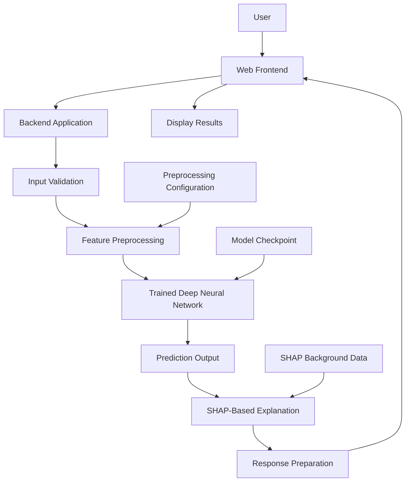

# Explainable Student Dropout Prediction Using Learning Behaviour Patterns and Deep Neural Networks

<p align="center">
  <strong>An Explainable AI Approach to Student Dropout Risk Prediction</strong>
</p>

<p align="center">
  <a href="https://github.com/keshavkarthik05/NeuralNetworks">GitHub Repository</a> •
  <a href="https://github.com/keshavkarthik05">Keshav Karthik</a> •
  <a href="https://github.com/saivikas35">Sree Sai Vikas V.M.</a>
</p>

---

## Table of Contents

1. [Project Overview](#1-project-overview)
2. [Problem Statement](#2-problem-statement)
3. [Motivation](#3-motivation)
4. [Project Objectives](#4-project-objectives)
5. [Proposed Solution](#5-proposed-solution)
6. [Key Features](#6-key-features)
7. [System Architecture](#7-system-architecture)
8. [Project Workflow](#8-project-workflow)
9. [Deep Neural Network](#9-deep-neural-network)
10. [Explainable Artificial Intelligence](#10-explainable-artificial-intelligence)
11. [Dataset and Feature Engineering](#11-dataset-and-feature-engineering)
12. [Technology Stack](#12-technology-stack)
13. [Repository Structure](#13-repository-structure)
14. [Installation and Setup](#14-installation-and-setup)
15. [Running the Application](#15-running-the-application)
16. [Model Evaluation](#16-model-evaluation)
17. [Understanding Predictions](#17-understanding-predictions)
18. [Reproducibility](#18-reproducibility)
19. [Security and Data Privacy](#19-security-and-data-privacy)
20. [Limitations](#20-limitations)
21. [Future Enhancements](#21-future-enhancements)
22. [Contributors](#22-contributors)
23. [License](#23-license)
24. [Acknowledgements](#24-acknowledgements)

---

## 1. Project Overview

Student dropout is an important challenge in education. Identifying students who may be at risk of discontinuing their studies can help educational institutions investigate learning difficulties and provide timely, appropriate support.

This project, **Explainable Student Dropout Prediction Using Learning Behaviour Patterns and Deep Neural Networks**, explores the application of deep learning and Explainable Artificial Intelligence (XAI) to student dropout risk prediction.

The system uses a trained Deep Neural Network (DNN) to generate dropout-risk predictions from student-related input features. It also incorporates SHAP-based explainability to help users investigate how different features influence the model's predictions.

The project integrates model inference, preprocessing configuration, explainability resources, and a web-based interface into a single application.

The implementation is organized into three main parts:

- **Backend:** Handles application logic and prediction-related operations.
- **Frontend:** Provides the user interface through HTML, CSS, and JavaScript.
- **Model artifacts:** Store the trained neural network, preprocessing configuration, evaluation information, and SHAP background data.

The overall goal is to explore a more interpretable approach to educational prediction systems rather than treating a neural network as a completely opaque model.

## 2. Problem Statement

Educational institutions may have access to large amounts of student information, including academic records, learning activity, assessment performance, and engagement indicators. However, identifying patterns associated with dropout risk can be difficult when these data sources are analysed manually or independently.

Traditional monitoring approaches may not capture complex relationships between multiple student-related variables. Deep learning can potentially model such relationships, but its predictions are often difficult to interpret.

A prediction alone does not explain why a student has been assigned a particular risk score.

This creates two related challenges:

1. **Prediction challenge:** How can a deep learning model use available student information to estimate dropout risk?
2. **Interpretability challenge:** How can users investigate the factors that contribute to an individual model prediction?

This project addresses these challenges by combining DNN-based prediction with SHAP-based explanations in a web application.

The system is intended as a research and educational prototype for exploring predictive modelling and interpretability in educational data mining.

## 3. Motivation

Educational prediction systems are more useful when their outputs can be examined and understood rather than accepted without question.

The motivation behind this project is to explore how predictive performance and interpretability can be considered together.

### 3.1 Early identification of potential risk

A predictive model can help identify patterns in historical student information that are associated with dropout outcomes. Such predictions may support further investigation by educators.

### 3.2 Learning behaviour analysis

Student engagement and academic activity can provide useful context for understanding educational outcomes. Analysing these patterns may reveal relationships that deserve further investigation.

### 3.3 Model transparency

Deep neural networks learn complex relationships through multiple layers of trainable parameters. Their internal decision-making processes are not directly interpretable from the model architecture alone.

Explainability techniques can provide additional insight into how input features affect predictions.

### 3.4 Responsible educational AI

Predictions about students should be handled carefully. Interpretability, validation, privacy, fairness, and human oversight are important considerations when developing educational AI systems.

## 4. Project Objectives

The primary objectives are:

- Develop a deep learning-based student dropout prediction system.
- Use student-related features to estimate dropout risk.
- Integrate a trained PyTorch model into an application backend.
- Maintain the preprocessing configuration required for model inference.
- Apply SHAP-based explainability to investigate model predictions.
- Provide a browser-based interface for interacting with the application.
- Organize the project into reusable backend, frontend, and model components.
- Establish a foundation for evaluating prediction quality and model interpretability.
- Explore the potential use of explainable predictive systems in educational research.

## 5. Proposed Solution

The proposed system combines predictive modelling and explainability in a modular application.

A user interacts with the frontend, which communicates with the backend. The backend prepares the input features using the configured preprocessing pipeline and passes the resulting representation to the trained neural network.

The model produces a prediction, which the application can present through the frontend. Where supported by the implementation, SHAP-based analysis is used to investigate the influence of input features on the prediction.

### Main components

**1. User interface**

Provides the browser-based interface for interacting with the prediction system.

**2. Backend processing**

Coordinates input handling, preprocessing, model inference, and the generation of prediction-related responses.

**3. Preprocessing configuration**

Contains configuration information required to transform input data into the feature representation expected by the trained model.

**4. Deep Neural Network**

Processes the prepared input features and generates a model output.

**5. Explainability component**

Uses SHAP-related resources to help investigate feature contributions.

**6. Results presentation**

Displays prediction-related information and any explanations supported by the application.

The exact input fields, response format, risk categories, and API endpoints depend on the implementation in the repository.

## 6. Key Features

### 6.1 Deep learning-based prediction

The project includes a saved PyTorch checkpoint for a trained neural network. The model can be used by the application to generate predictions from appropriately prepared input features.

### 6.2 Learning behaviour-oriented analysis

The project is designed around student-related information and learning behaviour patterns. The features available for prediction depend on the dataset and preprocessing pipeline used during model development.

### 6.3 Explainable AI integration

SHAP-based explanations can help investigate which features contribute positively or negatively to a prediction relative to a reference baseline.

### 6.4 Web-based interface

The frontend is separated from the backend, allowing the user interface and prediction logic to be maintained independently.

### 6.5 Modular project structure

The separation of application code, frontend assets, model artifacts, and dependencies makes the project easier to understand and extend.

### 6.6 Evaluation resources

The repository contains a metrics file intended to store evaluation information. The meaning and values of its contents should be verified against the model evaluation pipeline.

### 6.7 Reusable model artifacts

The trained model checkpoint and preprocessing configuration are stored separately from the application source code, making their roles easier to identify.

## 7. System Architecture

The application follows a modular architecture that separates user interaction, backend processing, prediction, and explainability.

### Architecture diagram



This diagram illustrates the intended logical workflow. The actual implementation may combine or omit individual stages depending on how `backend/main.py` is structured.

### Architecture components

| Component | Responsibility |
|---|---|
| Frontend | Collects input and presents results |
| Backend | Processes requests and coordinates prediction operations |
| Input validation | Checks whether received data meets application requirements |
| Preprocessing | Converts input features into the expected representation |
| DNN model | Generates predictions from prepared features |
| SHAP component | Investigates feature contributions to model outputs |
| Response handling | Prepares information for the frontend |

## 8. Project Workflow

The intended prediction workflow consists of the following stages.

### Stage 1: Input acquisition

The application receives student-related information through the available interface or supported backend input mechanism.

### Stage 2: Input validation

The backend checks the received input for missing fields, invalid values, and other issues defined by the application.

### Stage 3: Preprocessing

The input features are transformed into the numerical representation expected by the trained model.

Preprocessing must remain consistent with the process used during model training. Differences in feature ordering, categorical encoding, scaling, or missing-value handling can cause incorrect predictions.

### Stage 4: Model inference

The prepared feature vector is passed to the trained Deep Neural Network.

The model produces an output that must be interpreted according to the training objective and inference implementation.

### Stage 5: Explainability

SHAP-based analysis can be used to investigate how the input features contribute to the model output relative to a reference baseline.

### Stage 6: Results presentation

The backend returns the supported prediction and explanation information to the frontend, where it can be displayed to the user.

### Stage 7: Interpretation

The prediction and explanation are interpreted as model outputs rather than definitive statements about a student's future.

## 9. Deep Neural Network

The project uses a Deep Neural Network implemented with PyTorch.

A neural network consists of interconnected computational units arranged in layers. During training, the network learns parameters that map input features to the target output.

### 9.1 Input representation

The model requires input features in the representation expected by its trained parameters. The preprocessing configuration is therefore an important part of the inference pipeline.

### 9.2 Hidden layers

Hidden layers learn intermediate representations of the input. Nonlinear activation functions enable the network to model relationships that cannot be captured by a simple linear transformation alone.

### 9.3 Output layer

The output layer produces the model output. The meaning of that output depends on the training objective, output activation, and postprocessing logic.

For example, a binary classification system may use an output score to estimate the probability of one class. The precise interpretation must be confirmed from the model implementation.

### 9.4 Saved checkpoint

The trained checkpoint is stored at:

`backend/model/dropout_dnn.pt`

This file contains model-related parameters used by the application.

### 9.5 Preprocessing configuration

The preprocessing configuration is stored at:

`backend/model/preprocessing_config.json`

The preprocessing logic and configuration must remain compatible with the checkpoint.

### 9.6 Reproducibility considerations

Reliable inference requires consistency between training and deployment, including:

- Feature names and ordering
- Missing-value handling
- Numerical transformations
- Categorical encoding
- Model architecture
- Output interpretation
- Classification threshold, where applicable

The actual architecture and training hyperparameters should be documented from the model checkpoint and training code rather than inferred from the file name.

## 10. Explainable Artificial Intelligence

Explainable Artificial Intelligence aims to make model behaviour easier to investigate and understand.

In educational prediction systems, interpretability can help users examine why a model produces a particular output. It is especially relevant when model predictions may influence decisions about student support.

### 10.1 SHAP

SHAP stands for **SHapley Additive exPlanations**. It is based on Shapley values from cooperative game theory.

SHAP estimates the contribution of individual features to a prediction relative to a reference value or baseline.

In simplified terms, a feature contribution indicates how that feature moves the model output away from the reference prediction under the assumptions of the selected SHAP method.

### 10.2 Local explanations

A local explanation examines a particular prediction.

It can help answer questions such as:

- Which input features contributed most to this prediction?
- Which features moved the output higher or lower relative to the baseline?
- How does the model respond to this particular input?

A local explanation describes the model's behaviour for the selected input. It does not prove that the feature caused a real-world educational outcome.

### 10.3 Global explanations

Global analysis examines feature contributions across multiple predictions.

Depending on the analysis performed, it can help identify features that frequently influence the model and patterns in how the model uses the input variables.

Global importance should be interpreted carefully, particularly when features are correlated or the dataset contains sampling bias.

### 10.4 SHAP background data

The repository includes:

`backend/model/shap_background.npy`

SHAP background data can provide a reference distribution for certain explanation methods. Its interpretation depends on how the background data was selected and how the SHAP explainer is configured.

### 10.5 Why explainability matters

Explainability can help with:

- Investigating individual predictions
- Identifying unexpected model behaviour
- Communicating model outputs more transparently
- Exploring possible data quality problems
- Supporting model debugging and validation

### 10.6 Limitations of SHAP

SHAP explanations are not causal explanations. Their results depend on the model, the explainer, the reference data, and assumptions about feature relationships.

An influential feature should not automatically be interpreted as a factor that causes a student to drop out.

## 11. Dataset and Feature Engineering

The repository contains a student dataset at:

`backend/data/students.csv`

The dataset provides data for the application, but the precise source, collection process, feature definitions, and target-label construction should be documented from the original dataset and training pipeline.

### 11.1 Feature preparation

Before data can be processed by a neural network, it must be converted into a suitable numerical representation.

Depending on the training pipeline, preparation may involve:

- Handling missing values
- Encoding categorical variables
- Scaling numerical variables
- Selecting relevant features
- Maintaining consistent feature ordering
- Separating predictors from target labels

These steps must match the preprocessing configuration expected by the deployed model.

### 11.2 Data quality

Potential data quality issues include missing values, inconsistent categories, duplicate observations, inaccurate records, and differences between training and inference data.

Such issues can affect prediction reliability and should be considered during evaluation.

### 11.3 Data leakage

Features that reveal information unavailable at the intended prediction time can cause data leakage.

For example, using a final outcome or information recorded after a student has already discontinued their studies could produce misleading evaluation results.

The feature selection and train-test splitting process should therefore reflect the intended prediction scenario.

### 11.4 Data privacy

Student records may contain sensitive or personally identifiable information. Dataset licensing and privacy must be reviewed before publishing or distributing the data.

The presence of a dataset in a public repository does not automatically mean that it is appropriate to share.

## 12. Technology Stack

| Technology | Purpose |
|---|---|
| Python | Application and model-related programming |
| PyTorch | Deep learning model implementation and inference |
| FastAPI, if configured | Backend API framework |
| SHAP | Model explanation |
| NumPy | Numerical data handling and stored arrays |
| Pandas, where used | Tabular data processing |
| HTML | Frontend structure |
| CSS | Frontend presentation |
| JavaScript | Frontend behaviour and API communication |
| pip | Python dependency installation |
| Git | Version control |
| GitHub | Source code hosting and collaboration |

The definitive dependency list is maintained in `requirements.txt`.

## 13. Repository Structure

```text
NeuralNetworks/
│
├── backend/
│   ├── main.py
│   │
│   ├── data/
│   │   └── students.csv
│   │
│   └── model/
│       ├── dropout_dnn.pt
│       ├── metrics.json
│       ├── preprocessing_config.json
│       └── shap_background.npy
│
├── frontend/
│   ├── index.html
│   ├── script.js
│   └── style.css
│
├── requirements.txt
└── README.md
```

### File descriptions

**`backend/main.py`**

Contains the backend application logic. The exact routes, request schemas, model-loading behaviour, and response structure are defined by this file.

**`backend/data/students.csv`**

Contains the student data file included in the repository. Its use and distribution must comply with the relevant privacy and licensing requirements.

**`backend/model/dropout_dnn.pt`**

Contains the saved PyTorch model checkpoint used for inference.

**`backend/model/metrics.json`**

Stores model evaluation information, subject to the contents generated by the evaluation pipeline.

**`backend/model/preprocessing_config.json`**

Contains preprocessing-related configuration required by the application.

**`backend/model/shap_background.npy`**

Contains a NumPy array used as SHAP background data, depending on the explanation implementation.

**`frontend/index.html`**

Defines the structure of the web interface.

**`frontend/script.js`**

Contains client-side JavaScript for interface interactions and any configured backend communication.

**`frontend/style.css`**

Defines the appearance and layout of the interface.

**`requirements.txt`**

Lists the Python packages required by the application.

## 14. Installation and Setup

### Prerequisites

Before starting, ensure that you have:

- Python installed and compatible with the project dependencies
- Git installed
- A web browser
- A terminal or code editor
- Access to the repository and its required model artifacts

### Step 1: Clone the repository

```bash
git clone https://github.com/keshavkarthik05/NeuralNetworks.git
cd NeuralNetworks
```

### Step 2: Create a virtual environment

On Windows:

```powershell
python -m venv .venv
```

Activate the environment:

```powershell
.venv\Scripts\Activate.ps1
```

Alternatively, using Command Prompt:

```bat
.venv\Scripts\activate.bat
```

### Step 3: Install dependencies

Upgrade pip and install the project's dependencies:

```bash
python -m pip install --upgrade pip
pip install -r requirements.txt
```

If installation fails, check the Python version, package compatibility, and the error message.

### Step 4: Verify the required files

Ensure that the application can access the required model checkpoint and preprocessing configuration.

Check that the paths used in the code match the actual project structure.

## 15. Running the Application

The exact commands depend on the framework and application entry points configured in the repository.

### Step 1: Start the backend

If `backend/main.py` defines a FastAPI instance named `app`, a possible startup command from the repository root is:

```bash
uvicorn backend.main:app --reload
```

If the application instance has another name, or the project uses a different framework, adjust the command accordingly.

### Step 2: Access the backend

If the backend starts on the default local address and port, the base URL is commonly:

`http://127.0.0.1:8000`

If interactive FastAPI documentation is enabled, it is commonly available at:

`http://127.0.0.1:8000/docs`

These addresses are examples based on the default configuration, not a guarantee of the application's actual runtime settings.

### Step 3: Open the frontend

Open `frontend/index.html` in a browser or serve the frontend using an appropriate local development server.

If the frontend communicates with the backend, ensure that the API URL configured in `frontend/script.js` matches the running backend.

### Step 4: Test the application

1. Start the backend.
2. Open the frontend.
3. Provide input supported by the application.
4. Submit the request.
5. Verify that the application returns the expected response.
6. Inspect any displayed prediction and explanation.
7. Review the terminal logs if errors occur.

## 16. Model Evaluation

Evaluation helps determine whether the model generalizes beyond the data used for training.

The appropriate evaluation measures depend on the target definition, class distribution, and prediction objective.

### 16.1 Accuracy

Accuracy measures the proportion of predictions that match the true labels.

It can be misleading when the classes are imbalanced.

### 16.2 Precision

Precision measures the proportion of predicted positive cases that are actually positive.

In dropout prediction, its interpretation depends on which outcome is defined as the positive class.

### 16.3 Recall

Recall measures the proportion of actual positive cases correctly identified by the model.

Recall can be particularly relevant when missing a genuinely at-risk student is an important concern.

### 16.4 F1-score

The F1-score combines precision and recall using their harmonic mean.

It is useful when both measures matter, although it does not replace a full evaluation of model behaviour.

### 16.5 ROC-AUC

ROC-AUC measures the model's ability to rank positive cases above negative cases across classification thresholds.

It does not by itself establish that predicted probabilities are well calibrated.

### 16.6 Confusion matrix

A confusion matrix summarizes true positives, true negatives, false positives, and false negatives.

It can help identify the types of classification errors made by the model.

### 16.7 Explainability evaluation

Prediction performance alone does not establish that explanations are faithful or stable.

Further investigation can examine whether explanations remain consistent under small input changes, whether they reflect model behaviour, and whether they provide useful information for the intended users.

### Reporting results

Actual performance metrics should be extracted from the project's evaluation outputs and reported with their evaluation dataset, split strategy, class definitions, and threshold where applicable.

No numerical performance claims are made in this README because they should be supported by verified experimental results.

## 17. Understanding Predictions

A model prediction is an estimate generated from patterns learned during training. It should not be treated as a definitive statement about a student's future.

The interpretation of the output depends on the model's training objective, output activation, calibration, and postprocessing.

If the application displays a probability, confirm that the value represents a calibrated or otherwise appropriately interpreted probability rather than an arbitrary model score.

Similarly, if the interface displays risk categories, document the thresholds and explain how they were selected.

SHAP explanations can provide additional insight into the model's output, but they do not establish causality.

The system should be used to support further investigation and human judgment, not to replace them.

## 18. Reproducibility

Reproducibility is important for verifying the model's behaviour and evaluating future changes.

Recommended practices include:

- Recording the Python version and dependency versions
- Maintaining the model architecture and checkpoint consistently
- Preserving the preprocessing configuration
- Documenting feature definitions and ordering
- Recording the dataset version and source
- Documenting train-validation-test splitting
- Recording random seeds where applicable
- Reporting evaluation metrics from the same defined evaluation procedure
- Separating training data from independent test data
- Documenting changes to the model and inference pipeline

The current repository contains inference-related artifacts. A complete reproduction of training additionally requires the relevant training code, dataset source, configuration, and training procedure.

## 19. Security and Data Privacy

Student-related data must be handled responsibly.

Before deploying or distributing the project:

- Confirm that the dataset can legally and ethically be shared.
- Remove personally identifiable or confidential student information where necessary.
- Avoid committing API keys, passwords, access tokens, or private environment files.
- Review the security of file uploads and backend input handling.
- Restrict access to sensitive data and logs.
- Avoid exposing debugging information in production.
- Validate inputs before passing them to the model.
- Consider authentication, authorization, and rate limiting where appropriate.
- Review model artifacts and serialized files before loading them from untrusted sources.

The application should not be deployed with real student data until the relevant privacy, security, and institutional requirements have been addressed.

## 20. Limitations

This project has several limitations that should be considered when interpreting its outputs.

**Data dependency:** Model performance depends on the quality, completeness, and representativeness of the training data.

**Generalization:** Patterns learned from one dataset or educational context may not transfer to another.

**Prediction uncertainty:** A predicted risk score is not a guarantee that a student will or will not discontinue their studies.

**Explainability limitations:** SHAP explanations depend on the model, explainer, reference data, and assumptions about feature relationships.

**Potential bias:** Historical data may contain patterns reflecting existing inequalities or differences in access to educational resources.

**Data leakage risk:** Features unavailable at the intended prediction time can create misleading performance estimates.

**Human oversight:** Model predictions should not be the sole basis for consequential decisions affecting students.

**Deployment requirements:** A research prototype may require additional testing, validation, monitoring, and security measures before real-world use.

## 21. Future Enhancements

Potential extensions to this project include:

### Model improvements

- Compare alternative neural network architectures.
- Evaluate calibration and threshold-selection strategies.
- Investigate feature selection and robust preprocessing methods.
- Validate the model on independent datasets.

### Explainability improvements

- Evaluate explanation stability.
- Compare multiple explainability methods.
- Investigate local and global feature contributions.
- Measure explanation faithfulness using suitable evaluation procedures.

### Dashboard improvements

- Add aggregate cohort-level analytics.
- Introduce visualizations of learning behaviour over time.
- Improve error handling and input validation.
- Add clearer presentation of prediction uncertainty and explanation limitations.

### Research improvements

- Establish a documented experimental protocol.
- Evaluate model performance across relevant subgroups.
- Investigate data leakage and temporal validation.
- Study how explanation quality affects human interpretation.
- Document reproducible experimental results.

### Deployment improvements

- Add appropriate authentication and authorization.
- Introduce secure configuration management.
- Improve logging and monitoring.
- Separate development and production settings.
- Establish appropriate data retention and privacy controls.

These enhancements represent potential future work and are not claims about features already implemented.

## 22. Contributors

This project was developed collaboratively by:

### Keshav Karthik

GitHub: [@keshavkarthik05](https://github.com/keshavkarthik05)

### Sree Sai Vikas V.M.

GitHub: [@saivikas35](https://github.com/saivikas35)

Both contributors are credited here in the project documentation. Commit-level attribution and GitHub's automatically generated contributor statistics are maintained separately.

## 23. License

No open-source license has currently been specified for this repository.

Until a suitable license is added, users should not assume that they have permission to redistribute or reuse the project's code, dataset, or other materials.

A license should be selected only after confirming the rights to all included materials and agreeing on the intended reuse permissions.

## 24. Acknowledgements

This project explores the intersection of deep learning, educational data mining, and Explainable Artificial Intelligence.

We acknowledge the developers and researchers behind the open-source tools used in this work, including PyTorch, NumPy, SHAP, and the other libraries specified in the project's dependency configuration.

We also acknowledge the broader research community working toward more interpretable, responsible, and reliable machine learning systems for education.

---

<p align="center">
  <strong>Explainable AI for More Transparent Educational Prediction</strong>
</p>

<p align="center">
  Developed as an academic project exploring deep learning and model interpretability.
</p>
